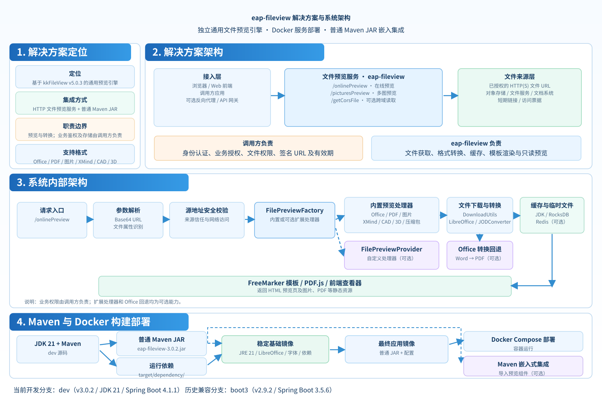
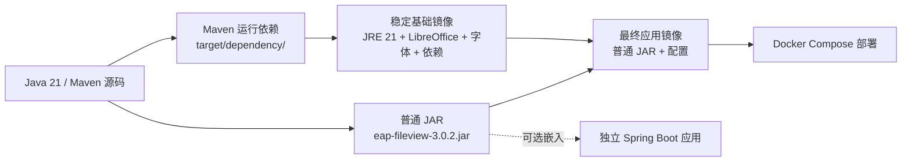

# eap-fileview

基于 [kkFileView v5.0.3](https://github.com/kekingcn/kkFileView) 演进的独立通用文件预览组件，支持 Docker 服务和普通 Maven JAR 二次开发，不依赖特定业务系统。

**当前默认开发分支 `dev`：v3.0.2 · JDK 21 · Spring Boot 4.1.1。**

## 架构与边界

- **通用预览能力**：沿用 kkFileView 的 Office / WPS、PDF / OFD、图片、压缩包、XMind、文本、CAD、3D 等预览能力。详细文件格式清单、示例截图、原始使用文档参见 [kkFileView 中文原版说明](doc/kkfileview/README.cn.md)。
- **通用扩展入口**：`FilePreviewProvider` 按文件属性注册处理器；`OfficePreviewFallbackConverter` 提供可选 Word 转 PDF 回退；`EapFileViewComponents` 供 Spring Boot 下游导入。
- **调用方负责授权**：文件来源系统负责身份、文件权限、授权链接和有效期；本项目只提供通用预览能力。
- **扩展边界清晰**：领域数据模型、专有转换器、存储适配和消息集成由使用方自行实现，不进入通用预览引擎。
- **上游独立演进**：kkFileView 上游保持只读；选择性合入格式或安全修复，避免覆盖本项目的 Spring Boot 4.1 依赖配置。

## 系统架构

方案图展示 eap-fileview 的定位、接入方式、内部处理、可选扩展以及 Maven/Docker 部署分层。由 GPT 根据当前代码整理，仓库使用可缩放的 SVG 形式维护。



其中 FilePreviewProvider、OfficePreviewFallbackConverter 都是可选扩展；用户鉴权及签名 URL 的有效期仍由调用方负责。

## 分支与版本

| 分支 | 定位 | 版本 / 技术基线 |
| --- | --- | --- |
| **`dev`** | **默认分支，唯一日常开发线** | **3.0.2 / JDK 21 / Spring Boot 4.1.1** |
| `boot3` | 历史 Boot 3.5 兼容快照，**不再单独维护** | 2.9.2 / JDK 21 / Spring Boot 3.5.6 |

新功能与修复从 `dev` 建立短期分支、经测试合入；完成 Docker 启动、平台测试和真实预览验收后，直接在审核通过的 `dev` 提交上创建正式版本标签。见 [分支规则](doc/BRANCHING.md)。

## 本地构建和测试

从仓库根目录使用 JDK 21、Maven 3.9：

```bash
java -version
mvn -B -pl server -am -DskipTests clean package
```

构建输出只有**普通 JAR**（例如 `server/target/eap-fileview-3.0.2.jar`）；`server/target/dependency/` 是供 Docker 使用的运行依赖目录。**不再生成可执行 Fat JAR** 或旧版压缩分发包。

运行本机可执行的核心测试（另外三项需有本机 LibreOffice / SevenZip 运行环境）：

```bash
mvn -B -pl server -am \
  '-Dtest=*,!EncodingTests,!ServerMainTests,!ArchiveTraversalSecurityTests' \
  -Dsurefire.failIfNoSpecifiedTests=false test
```

## Docker 独立部署

### Maven 与镜像分层



基础镜像随 Java、LibreOffice、字体或依赖更新；日常仅改本项目应用代码时，可复用它而不必重新构建运行环境。


正常部署使用已发布的镜像，不必在目标机器编译 Java：

```bash
cp .env.example .env
# 修改 .env 中的 KK_BASE_URL / KK_TRUST_HOST 等配置
docker compose up -d
```

自行构建镜像时，先执行上面的 Maven 打包命令，并先构建可复用的基础镜像：

```bash
docker build -f docker/Dockerfile.base \
  -t ghcr.io/eaopen/eap-fileview-base:java21-sb41-r1 .
docker compose -f compose.yaml -f compose.build.yaml build
docker compose -f compose.yaml -f compose.build.yaml up -d
```

**基础镜像**包含 JDK 21、LibreOffice、字体和 Maven 运行依赖；**应用镜像**在其上叠加普通 JAR 和配置。默认监听容器内 8012，Compose 映射本机 `127.0.0.1:18012`，上下文路径 `/fileview`。镜像是否已公开可拉取以 [GitHub Actions 发布记录](https://github.com/eaopen/eap-fileview/actions) 为准。

## Maven 依赖与二次开发

```xml
<dependency>
  <groupId>io.github.eaopen</groupId>
  <artifactId>eap-fileview</artifactId>
  <version>3.0.2</version>
</dependency>
```

下游以 `@Import(EapFileViewComponents.class)` 导入组件，使用自己的 Spring Boot 启动类并注册扩展 Bean。账号、Maven Central/CNB 权限、签名规范沿用 eap-boot 的组织体系；**仓库构建通过不等于 Maven Central 已发布**，下载前应确认对应制品已上架。细节参见 [扩展与发布设计](doc/EXTENSION_RELEASE.md)。

## 文档导航

- [解决方案与系统架构详解](doc/ARCHITECTURE.md)
- [扩展接口、Maven/JAR、Docker 镜像与发布](doc/EXTENSION_RELEASE.md)
- [通用 HTTP 文件预览集成规范](doc/HTTP_PREVIEW_INTEGRATION.md)
- [通用预览能力核查与改进记录](doc/PREVIEW_CAPABILITY_REVIEW.md)
- [分支与版本管理](doc/BRANCHING.md)
- [为何独立迁移 Spring Boot 4](doc/UPSTREAM_SPRING_BOOT4_ASSESSMENT.md)
- [kkFileView 原始中文 README（完整格式清单、截图及历史说明）](doc/kkfileview/README.cn.md)
- [kkFileView 原始英文 README](doc/kkfileview/README.md)
- [kkFileView 原始 AGENTS 指导（仅供参考，不是当前开发规则）](doc/kkfileview/AGENTS.md)
- [kkFileView 历史 CI 和 E2E 资料目录](doc/kkfileview/)

本项目保留上游原作者和许可证信息；需要了解上游原有命令或功能时请查阅归档资料，**不要直接把旧版 Windows 部署或 Boot 3 启动指令用于当前 `dev`**。
