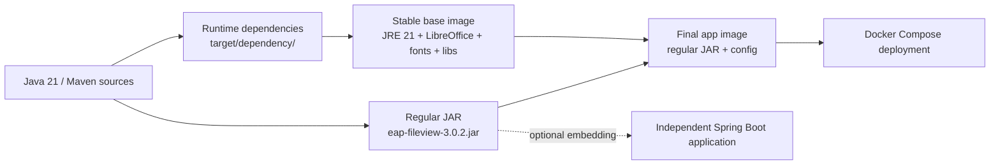

# eap-fileview

An **independently deployable and extensible file preview engine**, derived from [kkFileView v5.0.3](https://github.com/kekingcn/kkFileView). It runs as a Docker service or can be embedded through a **regular Maven JAR**, independently of any particular business application.

**Default and actively maintained branch: `dev` — v3.0.2, Java 21, Spring Boot 4.1.1.**

[中文说明](README.cn.md) · [Extensions and publishing](doc/EXTENSION_RELEASE.md) · [Branch rules](doc/BRANCHING.md) · [Original kkFileView documentation](doc/kkfileview/README.md)

## What it provides

- Preview Office/WPS, PDF/OFD, images, XMind, archives, text, CAD, 3D and other supported formats. The [preserved upstream README](doc/kkfileview/README.md) contains the full format list, examples and background.
- `FilePreviewProvider`, `OfficePreviewFallbackConverter` and `EapFileViewComponents` for downstream extensions.
- A generic URL-based preview service; the calling application owns user authentication, storage permission checks, short-lived download URLs and domain-specific workflows.
- Consumer-specific data models, proprietary converters, permission logic and integrations belong in the calling application.
- Targeted upstream bug fixes without overwriting the Boot 4.1 dependency baseline.

## System architecture

The solution diagram outlines the system boundary, HTTP endpoints, preview routing, optional extension contracts, and Maven/Docker deployment. It is a scalable SVG adaptation of the GPT-authored architecture design.


FilePreviewProvider and OfficePreviewFallbackConverter are optional. Authentication, authorization and signed URL expiry belong to the calling system.

## Branch status

| Branch | Purpose | Runtime |
| --- | --- | --- |
| **`dev`** | **Default, only actively maintained development branch** | **3.0.2 / Java 21 / Spring Boot 4.1.1** |
| `boot3` | Historical compatibility snapshot; **no separate maintenance** | 2.9.2 / Java 21 / Spring Boot 3.5.6 |

Create focused feature/fix branches from `dev`; after CI, Docker startup and representative preview checks, tag the approved `dev` commit for release. See [branch policy](doc/BRANCHING.md).

## Build the regular JAR

Requires JDK 21 and Maven 3.9:

```bash
java -version
mvn -B -pl server -am -DskipTests clean package
```

Output: `server/target/eap-fileview-3.0.2.jar`, with `server/target/dependency/` used only to assemble the reusable Docker runtime. **No executable JAR or legacy distribution archive.**

Run the portable test suite (three additional environment-dependent tests need LibreOffice or SevenZip JNI locally):

```bash
mvn -B -pl server -am \
  '-Dtest=*,!EncodingTests,!ServerMainTests,!ArchiveTraversalSecurityTests' \
  -Dsurefire.failIfNoSpecifiedTests=false test
```

## Docker deployment

### Maven artifacts and Docker layers



Rebuild the stable base only when the JDK, LibreOffice, fonts or dependency set changes. Ordinary application code updates can reuse it.


Using a **published** image:

```bash
cp .env.example .env
# Configure KK_BASE_URL and KK_TRUST_HOST inside .env
docker compose up -d
```

To build locally, package the JAR first, then:

```bash
docker build -f docker/Dockerfile.base \
  -t ghcr.io/eaopen/eap-fileview-base:java21-sb41-r1 .
docker compose -f compose.yaml -f compose.build.yaml build
docker compose -f compose.yaml -f compose.build.yaml up -d
```

The versioned intermediate image holds Java 21, LibreOffice, fonts and Maven runtime dependencies; the application image adds only the normal JAR and config. Compose defaults to `127.0.0.1:18012` and the `/fileview` context path. Verify actual [image publication status](https://github.com/eaopen/eap-fileview/actions) before attempting a pull.

## Downstream Java integration

```xml
<dependency>
  <groupId>io.github.eaopen</groupId>
  <artifactId>eap-fileview</artifactId>
  <version>3.0.2</version>
</dependency>
```

Import `EapFileViewComponents` in the consumer's own Spring Boot application and provide optional preview handler beans as needed. The Maven group, signing account and CNB/Central publication settings follow eap-boot. A passing CI build **does not guarantee publication to Maven Central**.

## Documentation

- [Solution and system architecture](doc/ARCHITECTURE.md)
- [Extension SPI, Docker images and Maven publishing](doc/EXTENSION_RELEASE.md)
- [Generic HTTP file preview integration](doc/HTTP_PREVIEW_INTEGRATION.md)
- [Generic preview capability review](doc/PREVIEW_CAPABILITY_REVIEW.md)
- [Branch policy and release promotion](doc/BRANCHING.md)
- [Spring Boot 4 migration assessment](doc/UPSTREAM_SPRING_BOOT4_ASSESSMENT.md)
- [Original kkFileView English README](doc/kkfileview/README.md)
- [Original kkFileView Chinese README, full format list and screenshots](doc/kkfileview/README.cn.md)
- [Original kkFileView AGENTS and historical CI/E2E docs](doc/kkfileview/)

The upstream authorship, license and original instructions are retained as references. Archived Boot 3 or Windows automation commands are **not current eap-fileview `dev` instructions**.
